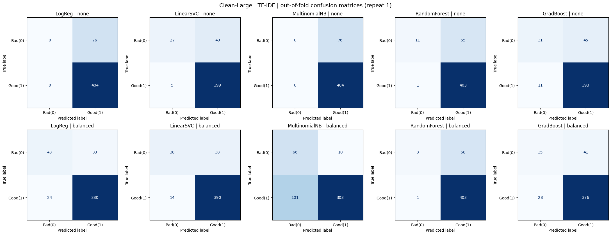

# Star Wars Dialogue Classification: Good vs. Bad

Can a model tell whether a Star Wars line was spoken by a hero (Luke, Leia) or a villain (Darth Vader, the Emperor) just from the words? I built and compared text classifiers to find out. This was an assignment for the course **인공지능모델운영 (Operation of AI Models)**, which I took as an international student in Korea.

> 한국어 요약: Cornell Movie-Dialogs Corpus의 스타워즈 대사로 Good(LUKE, LEIA) / Bad(DARTH VADER, EMPEROR) 이진 분류기를 만들고, 데이터 규모·벡터화(Count/TF-IDF)·5개 모델·class_weight·Sentence-BERT 임베딩을 비교했습니다. 보고서는 `reports/` 폴더에 있습니다.

## Key findings

| Question | Answer |
| --- | --- |
| Best overall model | TF-IDF + Logistic Regression (`class_weight='balanced'`): Macro-F1 0.763 ± 0.040 on the large set |
| Does more data help? | Yes for Macro-F1 and stability (19 of 20 setups improved), but Bad Recall barely moved |
| Is accuracy enough? | No. An unweighted model scored 0.842 accuracy while catching almost no villain lines (Bad Recall 0.003) |
| Count or TF-IDF? | TF-IDF for linear models, Count for Naive Bayes and Random Forest |
| Is Sentence-BERT worth it? | Yes on small data (Macro-F1 0.807 vs. 0.735). On the large set it found more villain lines but with lower precision |

## The data problem I found first

Before training anything, I read through the provided CSVs and found three issues:

1. **No Darth Vader lines at all.** The Cornell corpus labels him `VADER`, so filtering for `"DARTH VADER"` returned nothing.
2. **Lines from other movies.** Filtering by character name alone pulled in characters with the same name from other films, such as the Emperor from *Dune*.
3. **The "1000lines" file had 552 rows.** The corpus only has about 490 Star Wars lines for these four characters.

So I re-extracted the data from the original corpus, keeping only the three original Star Wars films (filtered by movie ID). The notebook keeps the provided files too, as a comparison.

| Dataset | LUKE | LEIA | VADER | EMPEROR | Total | Bad share |
| --- | --- | --- | --- | --- | --- | --- |
| Small (Part 1) | 94 | – | 25 | 6 | 125 | 24.8% |
| Large (Part 2) | 229 | 175 | 62 | 14 | 480 | 15.8% |

## Method

- **Models:** Logistic Regression, LinearSVC, Multinomial Naive Bayes, Random Forest, Gradient Boosting
- **Features:** `CountVectorizer` and `TfidfVectorizer` (unigrams + bigrams), plus Sentence-BERT (`all-MiniLM-L6-v2`) embeddings
- **Imbalance:** each model with and without `class_weight='balanced'` (or the equivalent `sample_weight`)
- **Evaluation:** repeated stratified 5-fold CV (5 repeats = 25 folds), identical splits for every setup
- **Leakage prevention:** vectorizer and classifier wrapped in one `Pipeline`, fitted on training folds only
- **Metrics:** Accuracy, Bad-class Precision / Recall / F1, Macro-F1 (mean ± SD), confusion matrices

## Results

| Data | Features | Model | Imbalance | Accuracy | Bad Recall | Bad F1 | Macro-F1 |
| --- | --- | --- | --- | --- | --- | --- | --- |
| Small | TF-IDF | LogReg | balanced | 0.813 | 0.567 | 0.593 | 0.735 ± 0.107 |
| Small | SBERT | LogReg | balanced | 0.858 | 0.708 | 0.710 | 0.807 ± 0.088 |
| Large | TF-IDF | LinearSVC | balanced | 0.890 | 0.537 | 0.605 | 0.771 ± 0.035 |
| Large | TF-IDF | LogReg | balanced | 0.876 | 0.587 | 0.599 | 0.763 ± 0.040 |
| Large | SBERT | LogReg | balanced | 0.847 | 0.722 | 0.599 | 0.752 ± 0.046 |
| Large | Count | Random Forest | none | 0.870 | 0.198 | 0.315 | 0.622 ± 0.074 |

All 68 configurations are in [`results/final_results_table.csv`](results/final_results_table.csv), and the Sentence-BERT comparison is in [`results/sbert_vs_tfidf_results.csv`](results/sbert_vs_tfidf_results.csv).



## Repository structure

```
├── starwars_text_classification.ipynb   # main notebook: data audit, Parts 1–3, error analysis
├── starwars_text_classification.py      # same notebook as a plain Python script
├── sbert_part3.py                       # Sentence-BERT vs. TF-IDF on the same folds
├── data/
│   ├── starwars_4char_100lines.csv      # provided by the course (has the issues above)
│   ├── starwars_4char_1000lines.csv     # provided by the course (has the issues above)
│   ├── starwars_clean_small_125.csv     # re-extracted, Part 1
│   └── starwars_clean_large_4char.csv   # re-extracted, Part 2
├── results/
│   ├── final_results_table.csv
│   ├── sbert_vs_tfidf_results.csv
│   └── figures/
├── reports/                             # 2-page reports (Korean and English)
└── requirements.txt
```

## How to run

```bash
pip install -r requirements.txt
jupyter notebook starwars_text_classification.ipynb
```

The notebook downloads the original Cornell corpus file (`movie_lines.txt`, about 34 MB) on first run, so it needs an internet connection. The full run takes about 10 minutes on a CPU.

The Sentence-BERT experiment is a separate script, because it needs to download a model from Hugging Face:

```bash
python sbert_part3.py
```

It also runs in Google Colab: upload the two `starwars_clean_*.csv` files, run `!pip install -q sentence-transformers`, then paste in the script.

## Limitations

- There are only 76 villain lines, so the top models are not statistically separable (Bad-metric SD of 0.06–0.10).
- The labels come from the character, not the line. A line like "Yes." can't really be classified, so these results are not a measure of sentiment or morality.
- The large set changes both the sample size and the cast (it adds Leia), so the effect of size alone isn't isolated.

## Data source

Cornell Movie-Dialogs Corpus: Cristian Danescu-Niculescu-Mizil and Lillian Lee, "Chameleons in imagined conversations: A new approach to understanding coordination of linguistic style in dialogs," *Workshop on Cognitive Modeling and Computational Linguistics, ACL 2011*.

## Author

Nicole Canlas, international student in Korea
